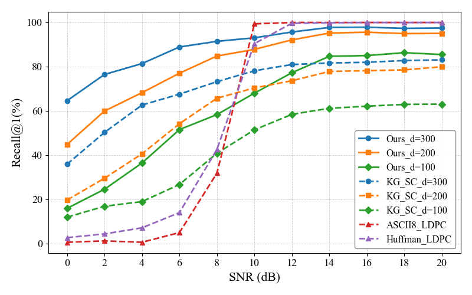
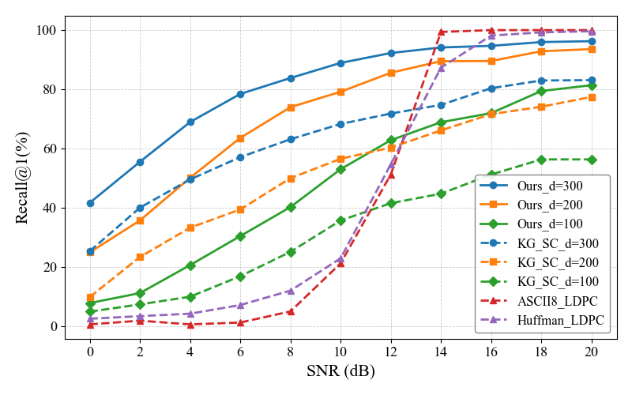
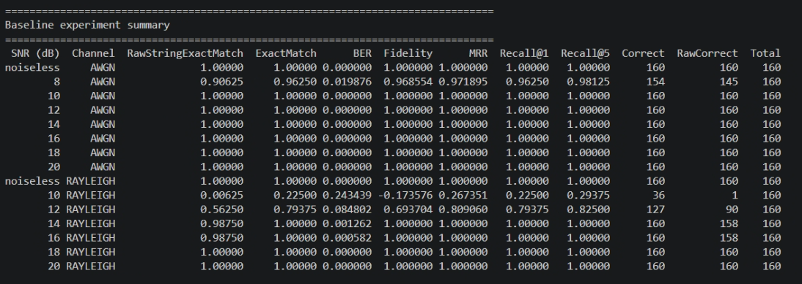

AWGN
 
Rayleigh

审稿人原话
>The physical channel also needs a consistent specification. Equation (18) applies the channel directly to the binary vector B, whereas Table X states that all schemes use 16-ary quadrature amplitude modulation (16-QAM). Document the modulation mapping, power normalization, fading and equalization assumptions, demodulation, and signal-to-noise ratio (SNR) definition.

1. 二值向量 \(B\) 如何调制为16QAM符号。
2. 发射信号如何归一化。
3. AWGN和Rayleigh信道如何定义。
4. 接收端如何均衡和解调。
5. SNR具体如何计算

## UTF-8

**你现在的“向量化 BP”仍然是 Sum-Product BP。** 两者采用相同的消息更新公式，主要区别是计算方式：原实现用 Python 循环逐条边计算，向量化实现用 NumPy 批量计算。

### 1. 原来的 Sum-Product BP 如何译码

LDPC 校验矩阵 \(H\) 对应一张 Tanner 图，包含两类节点：

- **变量节点**：对应码字中的各个比特。
- **校验节点**：对应一条奇偶校验约束。

当 \(H_{cv}=1\) 时，校验节点 \(c\) 与变量节点 \(v\) 相连。BP 就是在这些连接上反复交换消息，综合信道信息和校验约束，判断每个比特是 0 还是 1。

你的代码在 **LLR 域**计算。信道初始信息为：

\[
L_v^{\mathrm{ch}}
=\log\frac{P(b_v=0\mid y)}{P(b_v=1\mid y)}
\]

正值倾向于 0，负值倾向于 1，绝对值越大，表示判断越有把握。

每轮迭代主要包含以下步骤。

**① 校验节点向变量节点发送消息**

\[
r_{c\rightarrow v}
=
2\operatorname{atanh}
\left[
\prod_{u\in N(c)\setminus\{v\}}
\tanh\left(\frac{q_{u\rightarrow c}}{2}\right)
\right]
\]

其中 \(q_{u\rightarrow c}\) 是变量节点发来的消息。计算发往 \(v\) 的消息时，要排除 \(v\) 自己提供的信息。

**② 变量节点向校验节点发送消息**

\[
q_{v\rightarrow c}
=
L_v^{\mathrm{ch}}
+
\sum_{d\in N(v)\setminus\{c\}}r_{d\rightarrow v}
\]

同样排除接收方 \(c\) 的消息，避免把对方的信息直接传回去。

**③ 汇总信息并做硬判决**

\[
L_v^{\mathrm{post}}
=
L_v^{\mathrm{ch}}
+
\sum_{c\in N(v)}r_{c\rightarrow v}
\]

你的实现使用：

\[
\hat b_v=
\begin{cases}
0,&L_v^{\mathrm{post}}>0\\
1,&L_v^{\mathrm{post}}\leq 0
\end{cases}
\]

随后检查：

\[
H\hat{\boldsymbol b}\bmod 2=0
\]

满足时提前停止，否则继续迭代，直到达到最大迭代次数。**校验通过表示得到了合法码字，仍可能是另一个错误码字。**

### 2. 向量化 BP 改了什么

它保留上述公式，但重新组织数据和运算。

| 部分 | 原来的实现 | 当前向量化实现 |
|---|---|---|
| 消息存储 | 使用较大的二维数组 | 主要按 Tanner 图的实际连接存储 |
| 校验节点更新 | 多层循环逐边计算 | 批量计算 `tanh`、乘积和 `atanh` |
| 变量节点更新 | 逐节点、逐邻居求和 | 用 `np.bincount` 批量汇总 |
| 硬判决、校验 | 部分逐节点计算 | 数组运算批量完成 |

一个关键优化是**计算“排除自身的乘积”**。

假设某个校验节点收到四个经过 `tanh` 变换的值：

\[
t_1,t_2,t_3,t_4
\]

它需要分别计算：

\[
t_2t_3t_4,\quad
t_1t_3t_4,\quad
t_1t_2t_4,\quad
t_1t_2t_3
\]

原实现针对每条边重新遍历其他边，有较多重复乘法。向量化实现先计算**前缀乘积和后缀乘积**，再组合得到每个位置排除自身后的乘积。这既减少重复运算，也避免使用“总乘积除以自身”时遇到除零问题。

你的默认 \(d_c=8\)，这一优化会反复作用于每个校验节点、每轮迭代，因此提速明显。

### 3. 会影响实验性能吗

**理论上，向量化主要改善运行时间，译码能力应当保持一致。** 当前两种实现仍采用相同的：

- Sum-Product 更新规则和整轮节点更新顺序；
- 最大迭代次数；
- 消息限幅和提前停止条件。

实际计算中，乘法、求和顺序变化会产生微小浮点差异，少数处于判决临界位置的样本可能出现不同结果。已有测试中，两种实现的译码比特一致，但这不代表验证了所有输入。

另外，这次整体提速还包括**预计算信息位恢复矩阵、复用编码和调制结果**，所以观察到的提速并非全部来自 BP。

论文中可以描述为：

> 接收端采用 LLR 域 Sum-Product BP 译码，并通过基于 Tanner 图连接的 NumPy 向量化实现加速消息更新，保持原有迭代规则和停止条件。