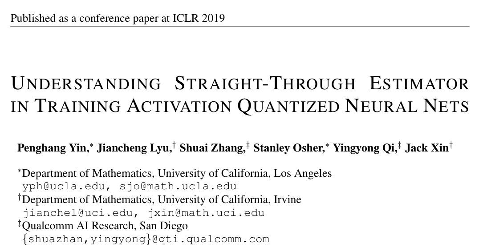
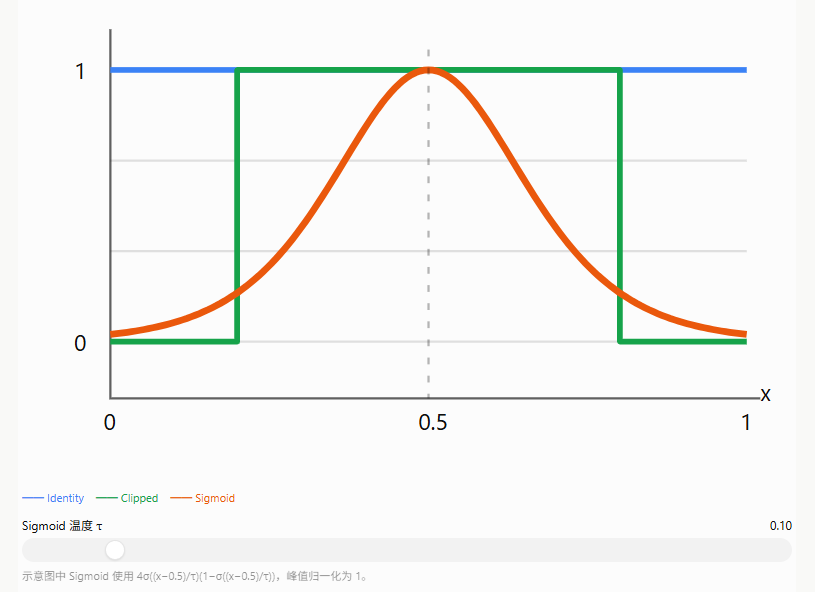
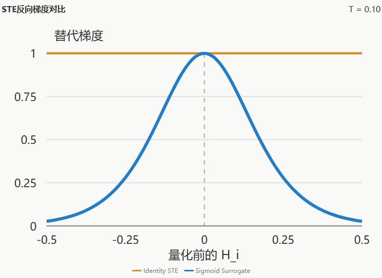
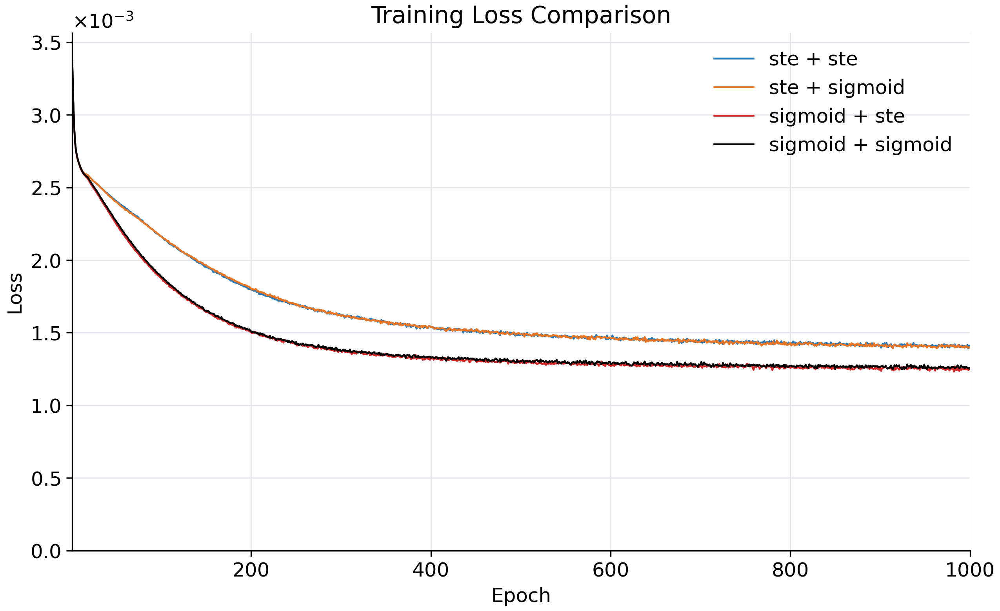
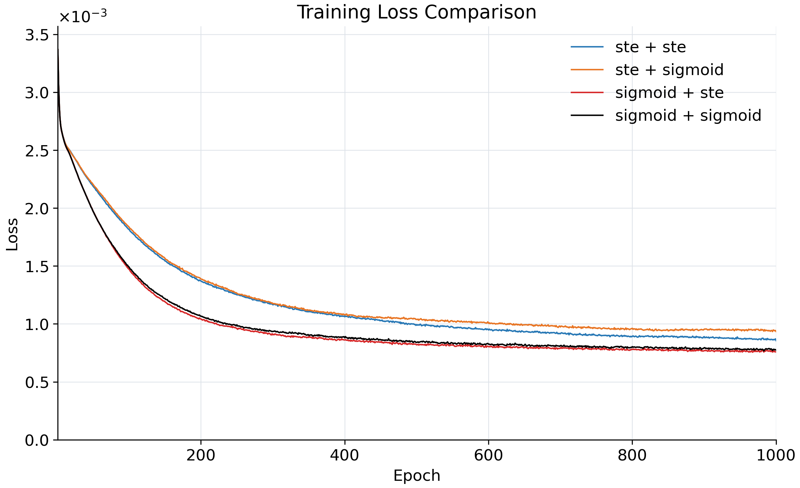

# STE消融相关论文



# STE替代梯度消融实验
**实验设置：** 压缩维度200，SNR为0 dB与10 dB；每组10个随机种子（33–42）。

## 一、机制介绍：STE与Sigmoid如何处理梯度
```python
def ste_binarize(x, mode="identity", temperature=0.1):
    A = Config.A

    # 两组实验使用完全相同的前向硬量化
    binary = tf.where(
        x >= 0.0,
        tf.ones_like(x) * A,
        tf.zeros_like(x)
    )

    if mode == "identity":
        # 原始恒等STE，反向梯度为1
        surrogate = x

    elif mode == "sigmoid":
        # 峰值归一化的Sigmoid替代梯度
        T = tf.cast(temperature, x.dtype)
        surrogate = 4.0 * T * (
            tf.sigmoid(x / T) - 0.5
        )

    else:
        raise ValueError("Unknown STE mode")

    # 前向输出始终为binary
    # 反向传播只经过surrogate
    return surrogate + tf.stop_gradient(
        binary - surrogate
    )
```


模型中有两处真正需要对硬判决进行梯度近似：**STE①位于发送端语义量化**，将连续特征变为0或0.01；**STE②位于接收端16QAM解调后**，将软比特变为0或1。两处都是硬阈值操作，普通求导几乎处处为零，因而不利于端到端训练。

**1. Identity STE（直通估计器）。** 可以把它理解为“**前向做硬判决，反向假装是直通的**”。例如，发送端某个特征为0.2，前向按阈值0量化为0.01；训练反向传播时，不使用硬阈值真实的零导数，而是近似把传回来的梯度原样传递给量化前特征：

$$
 y=u+\operatorname{sg}(Q(u)-u),\qquad \frac{\partial y}{\partial u}\approx1.
$$

其中$Q$是硬量化/硬判决，$\operatorname{sg}$表示停止梯度。STE②的输入软比特原本就在$[0,1]$内，原始实现还进行一次裁剪。

**2. Sigmoid Surrogate（Sigmoid替代梯度）。** **前向仍做同样的硬判决，只有反向传递梯度的规则发生变化。** 它不是把发送出去的比特改成连续Sigmoid值，而是让梯度更关注*接近判决阈值*的输入：

$$
\sigma(x) = \frac{1}{1 + e^{-x}}
$$

$$
\sigma'(x) = \sigma(x)\bigl(1 - \sigma(x)\bigr)
$$

$$
 g_{\rm sig}(u)=4\sigma\!\left(\frac{u-\theta}{T}\right)\!\left[1-\sigma\!\left(\frac{u-\theta}{T}\right)\right].
$$

$\theta$表示阈值，$T$表示温度；系数4使阈值处的梯度峰值与Identity STE一样为1。相比之下，Identity STE对距离阈值远近不同的输入均赋予约为1的梯度。例如，STE①中$H_i=0$时Sigmoid替代梯度为1，$H_i=0.3$时约为0.18，而Identity在两处均为1。两个位置采用不同的阈值和温度：

- **STE①（语义量化）：** $\theta_1=0$，Sigmoid温度$T_1=0.1$，前向输出$\{0,0.01\}$。
- **STE②（解调硬判决）：** $\theta_3=0.5$，Sigmoid温度$T_3=0.2$，前向输出$\{0,1\}$。

本次采用$2\times2$配置组合比较两处梯度估计策略；调制前的幅度归一化（原STE②所在位置）不作为本轮消融变量。

## 二、实验结果

下表为**10个随机种子的平均值 ± 样本标准差**，单位为%；配置顺序为“STE① / STE②”。

| SNR | STE① / STE② | 实体恢复准确率 | 去重实体恢复准确率 | 三元组精确恢复率 | 频率平衡三元组恢复率 |
|---|---|---:|---:|---:|---:|
| 0 dB | Identity / Identity（基线） | 69.19 ± 2.91 | 58.66 ± 3.20 | 25.43 ± 4.97 | 35.44 ± 4.68 |
| 0 dB | Sigmoid / Identity | 75.89 ± 2.68 | 67.42 ± 2.37 | 36.68 ± 4.77 | 47.25 ± 5.52 |
| 0 dB | Identity / Sigmoid | 65.70 ± 3.59 | 55.41 ± 3.33 | 23.54 ± 4.31 | 32.61 ± 3.66 |
| 0 dB | Sigmoid / Sigmoid | 74.96 ± 2.30 | 65.98 ± 1.82 | 35.05 ± 4.42 | 46.10 ± 4.75 |
| 10 dB | Identity / Identity（基线） | 84.19 ± 4.22 | 82.53 ± 1.97 | 55.21 ± 11.70 | 71.37 ± 6.72 |
| 10 dB | Sigmoid / Identity | 93.09 ± 5.67 | 88.87 ± 1.74 | 79.94 ± 16.47 | 88.32 ± 5.56 |
| 10 dB | Identity / Sigmoid | 81.97 ± 1.79 | 78.92 ± 1.87 | 49.40 ± 4.27 | 64.79 ± 6.20 |
| 10 dB | Sigmoid / Sigmoid | 90.42 ± 5.95 | 87.78 ± 1.80 | 72.01 ± 17.42 | 83.70 ± 6.57 |

从表中可以看出：

- **STE①改用Sigmoid带来主要收益。** 在STE②保持Identity时，三元组精确恢复率由0 dB下的**25.43%提升至36.68%（+11.25个百分点）**，10 dB下由**55.21%提升至79.94%（+24.73个百分点）**。
- **仅修改STE②没有带来提升。** 当STE①保持Identity时，STE②改用Sigmoid后，三元组精确恢复率在0 dB下由25.43%降至23.54%，在10 dB下由55.21%降至49.40%。
- **两处同时使用Sigmoid也并非最优。** 组合Sigmoid / Sigmoid的三元组精确恢复率分别为35.05%（0 dB）、72.01%（10 dB），均低于**Sigmoid / Identity**的36.68%和79.94%。四组中，后者在两个SNR下的四项指标均取得最高均值。

## 三、Loss曲线
### 0 dB SNR

### 10 dB SNR


