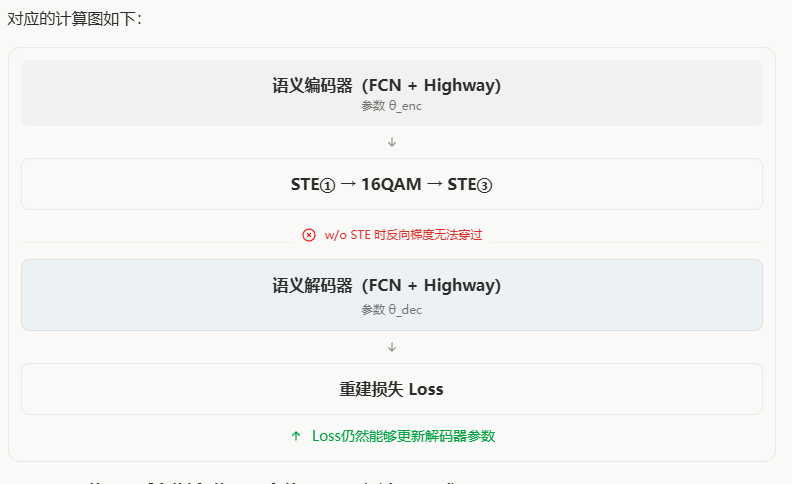

# w/o ste实验结果
| 条件 | 方法 | Entity acc. | Unique test IDs | Triple exact-match | Freq-balanced |
|---|---|---:|---:|---:|---:|
| 0dB | w/o ste | 28.55% | 17.18% | 2.21% | 3.01% |
| 0dB | w/ ste | **71.76%** | **61.00%** | **29.98%** | **39.20%** |
| 10dB | w/o ste | 81.38% | 73.20% | 47.15% | 59.15% |
| 10dB | w/ ste | **82.34%** | **81.10%** | **50.10%** | **66.59%** |

# 解释

最终损失：
$$
\mathcal L=\|X-\hat X\|^2
$$

解码器参数损失：

$$
\boxed{
\frac{\partial\mathcal L}{\partial\theta_{\mathrm{dec}}}
=
\frac{\partial\mathcal L}{\partial\hat X}
\frac{\partial\hat X}{\partial\theta_{\mathrm{dec}}}
}
$$
编码器参数损失：

$$
\boxed{
\frac{\partial\mathcal L}{\partial\theta_{\mathrm{enc}}}
=
\frac{\partial\mathcal L}{\partial\hat X}
\frac{\partial\hat X}{\partial\hat B}
\frac{\partial\hat B}{\partial H}
\frac{\partial H}{\partial\theta_{\mathrm{enc}}}
}
$$

$\frac{\partial\hat B}{\partial H}$时经过硬量化、16QAM和硬盘决，当把STE改为return binary的时候，反向传播路径就断开了。

w/ STE： 编码器和解码器能够通过重建损失联合优化。
w/o STE： 编码器的重建损失梯度路径断开，但解码器仍然能够学习如何从固定的二值表示恢复语义特征。