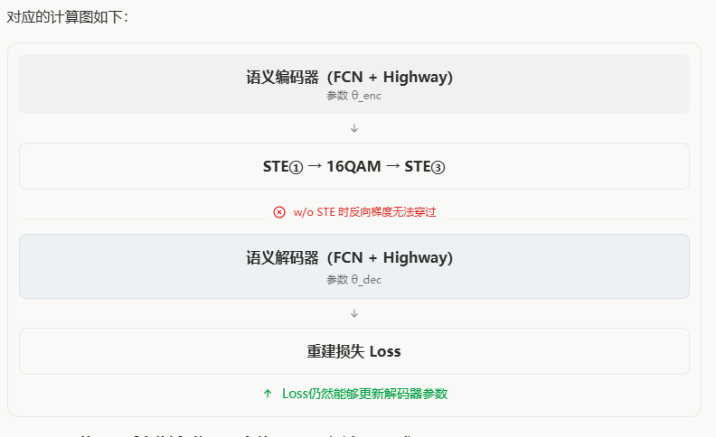

## 一、实验动机与设计依据

审稿人提出：

> The STE itself introduces training gradient bias. The paper conducts no ablation experiments for STE and fails to analyze the performance loss brought by STE.

模型中有两处主要的不可微操作：**STE①（发送端语义量化）** 将连续特征映射至 $\{0,A\}$，其中 $A=0.01$；**STE③（接收端硬判决）** 将 16-QAM 软解调得到的软比特映射至 $\{0,1\}$。原代码中还有调制前的 STE②，用于 $\{0,A\}\to\{0,1\}$ 的比特转换；本次实验统一采用可微的 $B/A$ 进行归一化，不将这一环节作为消融变量。

硬量化和硬判决的真实导数几乎处处为零，直接使用硬输出将阻断上游网络的梯度。直通估计器（STE）通过**前向执行硬判决、反向使用替代梯度**解决这一训练障碍，但替代梯度并不等于真实梯度，其选择可能影响优化过程。

**为什么采用“替换反向梯度”的消融？** Yin 等人在 ICLR 2019 的研究 [1] 中比较了 Identity、ReLU、Clipped ReLU 等不同 STE，说明在量化网络中研究不同替代梯度的优化效果是一种有依据的实验方式。借鉴的是**保持前向离散量化不变、比较反向梯度估计**的设计原则。

基于审稿意见，实验分为两个层次：

1. **w/ STE 与 w/o STE：** 验证硬判决处的替代梯度对端到端训练以及恢复性能的影响。
2. **Identity 与 Sigmoid 的四组组合：** 前向通信过程不变，仅改变 STE①、STE③的反向梯度近似，分析训练收敛及性能敏感性。

这两类实验回答的问题不同：**w/o STE 主要检验梯度路径是否被阻断；Identity/Sigmoid 对照才用于比较不同梯度近似策略的性能影响。**

## 二、机制与实验设置

### 1. Identity STE 和 Sigmoid Surrogate

设硬量化（或硬判决）函数为 $Q(x)$。

**Identity STE：** 前向输出仍为 $Q(x)$，反向传播时近似认为该节点的导数为 1：

$$
y_{\mathrm{id}}=x+\operatorname{sg}\big(Q(x)-x\big),
\qquad \frac{\partial y_{\mathrm{id}}}{\partial x}\approx 1.
$$

直观上，硬判决仍然存在，但训练时让来自下游的梯度直接通过。

**Sigmoid Surrogate：** 前向同样输出 $Q(x)$，但反向梯度随输入到判决阈值的距离变化：

$$
\begin{aligned}
S_T(x)&=4T\left[\sigma\!\left(\frac{x-\theta}{T}\right)-\frac12\right],\\
y_{\mathrm{sig}}&=S_T(x)+\operatorname{sg}\big(Q(x)-S_T(x)\big),\\
\frac{\partial y_{\mathrm{sig}}}{\partial x}
&\approx4\sigma\!\left(\frac{x-\theta}{T}\right)
\left[1-\sigma\!\left(\frac{x-\theta}{T}\right)\right].
\end{aligned}
$$

其中 $\theta$ 为硬判决阈值，$T$ 控制梯度集中程度；系数 4 使替代梯度在阈值处的峰值为 1。与 Identity STE 相比，Sigmoid **更强调靠近判决阈值的输入，减小远离阈值位置的梯度**。两者在同一输入下的**前向输出完全相同**，差别仅在反向传播。

| 模块 | 前向输出 | 阈值 $\theta$ | Sigmoid 温度 |
|---|---|---:|---:|
| STE①：语义量化 | $\{0,0.01\}$ | 0 | $T_1=0.1$ |
| STE③：软解调后的硬判决 | $\{0,1\}$ | 0.5 | $T_3=0.2$ |

### 2. 消融分组

- **梯度策略消融：** STE①、STE③分别取 Identity 或 Sigmoid，形成 4 种组合；每种组合在 0、10 dB 下分别运行 10 个随机种子（33–42）。
- **直接移除 STE：** STE①和STE③均改为直接返回硬判决结果（如 `return binary`、`return x_hard`）；每个 SNR 运行 3 个随机种子（40–42）。
- **梯度检查：** 使用 TensorFlow `tf.gradients(loss, ...)` 检查损失与发送端参数、解码器输入之间的反向传播路径。

## 三、实验结果与分析

### 1. 四种替代梯度组合（10 个随机种子）

以下结果为 **均值 ± 样本标准差**，单位均为百分比（%）：

| SNR | STE① / STE③ | 实体恢复准确率 | 去重实体准确率 | 三元组精确恢复率 | 频率平衡三元组恢复率 |
|---|---|---:|---:|---:|---:|
| 0 dB | Identity / Identity | 69.19 ± 2.91 | 58.66 ± 3.20 | 25.43 ± 4.97 | 35.44 ± 4.68 |
| 0 dB | **Sigmoid / Identity** | **75.89 ± 2.68** | **67.42 ± 2.37** | **36.68 ± 4.77** | **47.25 ± 5.52** |
| 0 dB | Identity / Sigmoid | 65.70 ± 3.59 | 55.41 ± 3.33 | 23.54 ± 4.31 | 32.61 ± 3.66 |
| 0 dB | Sigmoid / Sigmoid | 74.96 ± 2.30 | 65.98 ± 1.82 | 35.05 ± 4.42 | 46.10 ± 4.75 |
| 10 dB | Identity / Identity | 84.19 ± 4.22 | 82.53 ± 1.97 | 55.21 ± 11.70 | 71.37 ± 6.72 |
| 10 dB | **Sigmoid / Identity** | **93.09 ± 5.67** | **88.87 ± 1.74** | **79.94 ± 16.47** | **88.32 ± 5.56** |
| 10 dB | Identity / Sigmoid | 81.97 ± 1.79 | 78.92 ± 1.87 | 49.40 ± 4.27 | 64.79 ± 6.20 |
| 10 dB | Sigmoid / Sigmoid | 90.42 ± 5.95 | 87.78 ± 1.80 | 72.01 ± 17.42 | 83.70 ± 6.57 |

**主要发现：**

- **发送端 STE①：** 当接收端保持 Identity 时，STE①改用 Sigmoid 使三元组精确恢复率在 **0 dB 提高 11.25 个百分点**（25.43% → 36.68%），在 **10 dB 提高 24.73 个百分点**（55.21% → 79.94%）。
- **接收端 STE③：** 当发送端保持 Identity 时，STE③改用 Sigmoid 后，三元组精确恢复率在 0 dB、10 dB 分别降低约 **1.89、5.82 个百分点**。
- **最佳组合：** 在已测试的四组中，**STE① = Sigmoid、STE③ = Identity** 在两个 SNR 下均取得最高的四项指标平均值。说明替代梯度的效果与具体离散操作位置有关，而不是统一采用 Sigmoid 就会更好。
- **训练 Loss：** 原始 Loss 曲线显示，STE①采用 Sigmoid 的组合下降较快，最终训练损失也更低；但图中未注明是否为 10 个种子的平均曲线，因此只作为收敛趋势观察。

值得注意的是，10 dB 下部分组合的三元组精确恢复率标准差较大（例如 Sigmoid / Identity 为 16.47 个百分点）。高频实体或三元组恢复成败可能造成波动，但这一解释尚需按频率分组的错误分析来检验。

### 2. w/ STE 与 w/o STE（3 个随机种子）

下表为 3 个种子的平均准确率：

| SNR | 方法 | 实体恢复准确率 | 去重实体准确率 | 三元组精确恢复率 | 频率平衡三元组恢复率 |
|---|---|---:|---:|---:|---:|
| 0 dB | w/o STE①、③ | 28.55% | 17.18% | 2.21% | 3.01% |
| 0 dB | **w/ STE①、③** | **71.76%** | **61.00%** | **29.98%** | **39.20%** |
| 10 dB | w/o STE①、③ | 81.38% | 73.20% | 47.15% | 59.15% |
| 10 dB | **w/ STE①、③** | **82.34%** | **81.10%** | **50.10%** | **66.59%** |

**结果解读：** 0 dB 时，移除 STE 后三元组精确恢复率由 29.98% 降为 2.21%，下降 **27.77 个百分点**；10 dB 下该指标仅相差 **2.95 个百分点**，但去重实体准确率和频率平衡三元组准确率仍分别相差 **7.90、7.43 个百分点**。由于仅有 3 个随机种子，不据此宣称统计显著性。

### 3. 梯度传播验证与机制解释

计算图检查结果如下：

| 梯度检查对象 | w/o STE①、③ | w/ STE①、③ |
|---|---|---|
| `fcl1` / `highway1` 的受检编码器参数 | DISCONNECTED | CONNECTED |
| 编码器输出 `highway_1` | DISCONNECTED | CONNECTED |
| 解码器输入 `quantization_after_channel` | CONNECTED | CONNECTED |

这表明：**同时去掉STE①、STE③后，当前重建损失无法向编码器传播梯度，但解码器仍保留梯度路径。** `DISCONNECTED` 表示 `tf.gradients` 返回 `None`；`CONNECTED` 表示图中有可微路径，不代表梯度必然非零。

若将语义编码器表示为 $H=f_{\mathrm{enc}}(X;\theta_{\mathrm{enc}})$，通信后表示为 $\hat B$，解码器输出为 $\hat X=f_{\mathrm{dec}}(\hat B;\theta_{\mathrm{dec}})$，重建损失为 $\mathcal L=\|X-\hat X\|^2$，则：

$$
\frac{\partial\mathcal L}{\partial\theta_{\mathrm{dec}}}
=\frac{\partial\mathcal L}{\partial\hat X}
\frac{\partial\hat X}{\partial\theta_{\mathrm{dec}}},
$$

而编码器参数梯度还需要穿过不可微的通信相关操作：

$$
\frac{\partial\mathcal L}{\partial\theta_{\mathrm{enc}}}
=\frac{\partial\mathcal L}{\partial\hat X}
\frac{\partial\hat X}{\partial\hat B}
\frac{\partial\hat B}{\partial H}
\frac{\partial H}{\partial\theta_{\mathrm{enc}}}.
$$

因此，**解码器参数更新不要求梯度穿过前面的硬判决；编码器更新则需要经过这些节点。** w/o STE 的结果可以理解为：解码器仍能学习固定编码输出与目标语义之间的映射。在 10 dB 下，信道干扰较弱，固定的量化表示仍可能支持较高恢复率；在 0 dB 下，这种表示可能缺乏通过联合训练获得的抗噪声能力。这与实验观察一致，但不是已经被单独验证的因果解释。

## 四、结论与审稿回复

1. **直接移除STE会改变训练能力。** w/o STE 不等于整个模型无法训练，而是发送端编码器的重建损失梯度路径被阻断；该组主要用于展示梯度传播的作用。
2. **替代梯度的具体选择影响模型性能。** 四组实验在前向量化和物理信道保持一致的条件下比较反向梯度，发现发送端采用 Sigmoid 能显著改善已测试设置下的平均恢复性能和 Loss 趋势。
3. **不同离散节点对梯度策略的敏感性不同。** 已测试的最佳组合是 **STE① Sigmoid（$T_1=0.1$）+ STE③ Identity**，而不是两处均使用 Sigmoid。
4. **结果不能解释为STE的绝对梯度偏差。** Sigmoid本身仍是替代梯度方法；Identity与Sigmoid的性能差距说明梯度估计策略有可观测的优化代价，不能证明某个估计器无偏。10 dB 下的种子波动也仍需进一步分析。

**总体结论：** 本次消融使用“是否维持反向传播路径”与“如何近似硬判决梯度”两类互补实验，直接回应审稿人对 STE 消融和性能影响分析不足的意见。参考文献 [1] 主要用于**支持梯度估计器对比这一实验设计方法**

## 五、参考文献

[1] Yin, P., Lyu, J., Zhang, S., et al. **Understanding Straight-Through Estimator in Training Activation Quantized Neural Nets.** *International Conference on Learning Representations (ICLR)*, 2019. https://arxiv.org/abs/1903.05662
