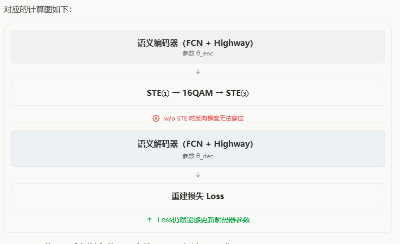

# 0dB,200dim
## w/o ste
### seed = 42
Output dimension: 200
Recovered entity accuracy: 32.19%
Recovered entity accuracy on unique test IDs: 20.10%
Recovered triple exact-match accuracy: 3.02%
Frequency-balanced triple recovery accuracy: 3.80%

### seed = 41
Output dimension: 200
Recovered entity accuracy: 28.57%
Recovered entity accuracy on unique test IDs: 18.56%
Recovered triple exact-match accuracy: 1.61%
Frequency-balanced triple recovery accuracy: 2.40%4

### seed = 40
Output dimension: 200
Recovered entity accuracy: 24.88%
Recovered entity accuracy on unique test IDs: 12.89%
Recovered triple exact-match accuracy: 2.01%
Frequency-balanced triple recovery accuracy: 2.84%

## w/ ste
### seed = 42
Output dimension: 200
Recovered entity accuracy: 71.90%
Recovered entity accuracy on unique test IDs: 60.31%
Recovered triple exact-match accuracy: 29.38%
Frequency-balanced triple recovery accuracy: 36.51%

### seed = 41
Output dimension: 200
Recovered entity accuracy: 70.96%
Recovered entity accuracy on unique test IDs: 58.76%
Recovered triple exact-match accuracy: 29.38%
Frequency-balanced triple recovery accuracy: 36.90%

### seed = 40
Output dimension: 200
Recovered entity accuracy: 72.43%
Recovered entity accuracy on unique test IDs: 63.92%
Recovered triple exact-match accuracy: 31.19%
Frequency-balanced triple recovery accuracy: 44.20%

# 10dB,200dim
## w/o ste
### seed = 42
Output dimension: 200
Recovered entity accuracy: 81.02%
Recovered entity accuracy on unique test IDs: 72.68%
Recovered triple exact-match accuracy: 45.88%
Frequency-balanced triple recovery accuracy: 57.06%

### seed = 41
Output dimension: 200
Recovered entity accuracy: 79.81%
Recovered entity accuracy on unique test IDs: 73.20%
Recovered triple exact-match accuracy: 42.86%
Frequency-balanced triple recovery accuracy: 56.84%

### seed = 40
Output dimension: 200
Recovered entity accuracy: 83.30%
Recovered entity accuracy on unique test IDs: 73.71%
Recovered triple exact-match accuracy: 52.72%
Frequency-balanced triple recovery accuracy: 63.56%

## w/ ste
### seed = 42
Output dimension: 200
Recovered entity accuracy: 80.01%
Recovered entity accuracy on unique test IDs: 80.41%
Recovered triple exact-match accuracy: 44.87%
Frequency-balanced triple recovery accuracy: 64.32%

### seed = 41
Output dimension: 200
Recovered entity accuracy: 82.36%
Recovered entity accuracy on unique test IDs: 80.41%
Recovered triple exact-match accuracy: 49.90%
Frequency-balanced triple recovery accuracy: 62.91%

### seed = 40
Output dimension: 200
Recovered entity accuracy: 84.64%
Recovered entity accuracy on unique test IDs: 82.47%
Recovered triple exact-match accuracy: 55.53%
Frequency-balanced triple recovery accuracy: 72.53%

# 总结
| 条件 | 方法 | Entity acc. | Unique test IDs | Triple exact-match | Freq-balanced |
|---|---|---:|---:|---:|---:|
| 0dB | w/o ste | 28.55% | 17.18% | 2.21% | 3.01% |
| 0dB | w/ ste | **71.76%** | **61.00%** | **29.98%** | **39.20%** |
| 10dB | w/o ste | 81.38% | 73.20% | 47.15% | 59.15% |
| 10dB | w/ ste | **82.34%** | **81.10%** | **50.10%** | **66.59%** |

最终损失：
$$
\mathcal L=\|X-\hat X\|^2
$$

解码器参数损失：

$$
\boxed{
\frac{\partial\mathcal L}{\partial\theta_{\mathrm{dec}}}
=
\frac{\partial\mathcal L}{\partial\hat X}
\frac{\partial\hat X}{\partial\theta_{\mathrm{dec}}}
}
$$
编码器参数损失：

$$
\boxed{
\frac{\partial\mathcal L}{\partial\theta_{\mathrm{enc}}}
=
\frac{\partial\mathcal L}{\partial\hat X}
\frac{\partial\hat X}{\partial\hat B}
\frac{\partial\hat B}{\partial H}
\frac{\partial H}{\partial\theta_{\mathrm{enc}}}
}
$$

$\frac{\partial\hat B}{\partial H}$时经过硬量化、16QAM和硬盘决，当把STE改为return binary的时候
