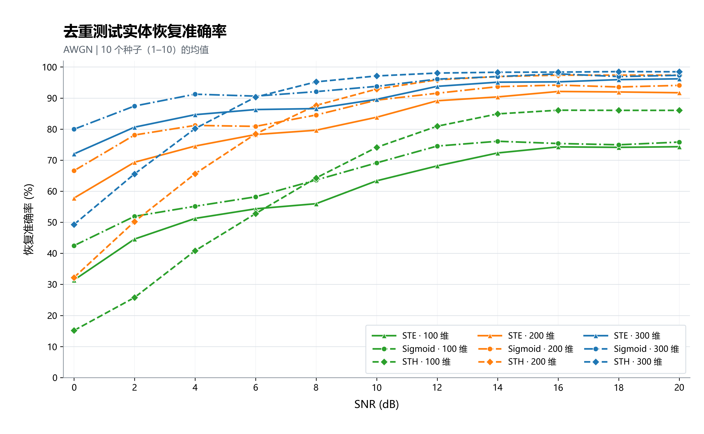
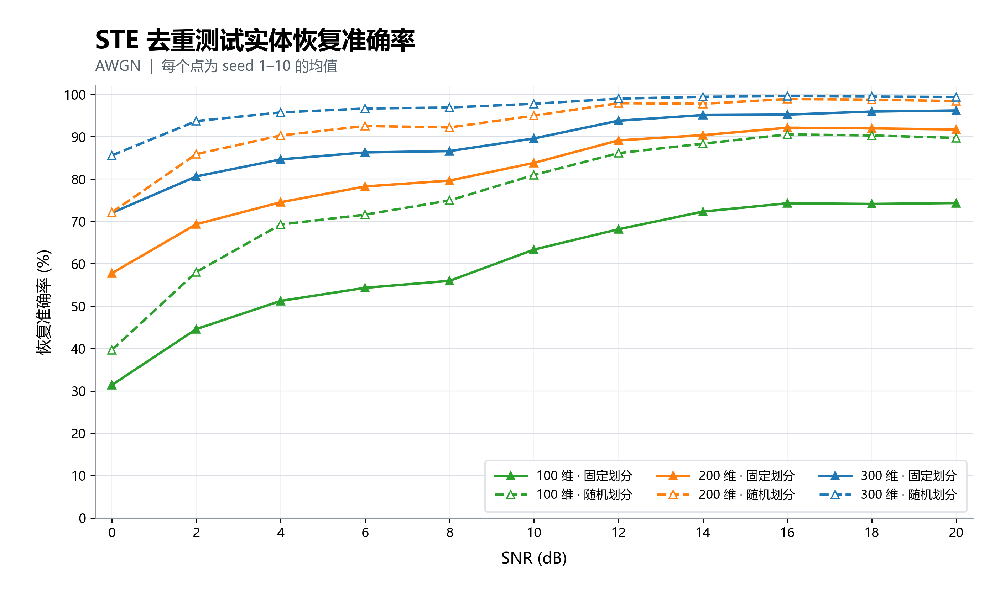

# 8dB 200dim
| 方法 | 实体恢复率（160 个） | 关系恢复率（34 个） | 去重测试实体恢复率（194 个） |
|---|---:|---:|---:|
| STE | 82.75 ± 2.21 | 65.00 ± 6.57 | 79.64 ± 1.50 |
| Sigmoid | 86.81 ± 1.60 | 73.82 ± 3.78 | 84.54 ± 1.57 |
| STH | **89.13 ± 1.70** | **80.59 ± 5.04** | **87.63 ± 1.72** |

训练集有 479 个实体、12 种关系，关系只占训练向量的 2.44%。测试集有 160 个实体、34 种关系

| 划分方式 | 实体恢复率 | 关系恢复率 | 总去重恢复率 |
|---|---:|---:|---:|
| 原固定划分，同为 seed 1 | 84.38%（135/160） | 61.76%（21/34） | 80.41%（156/194） |
| 本次随机划分，训练 70%、测试 30% | **95.26%（181/190）** | **87.50%（14/16）** | **94.66%（195/206）** |

