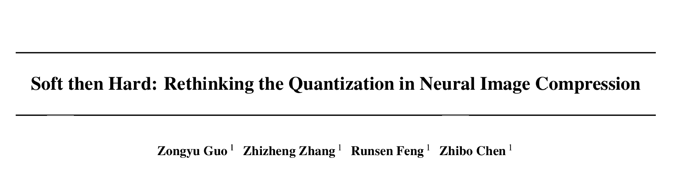
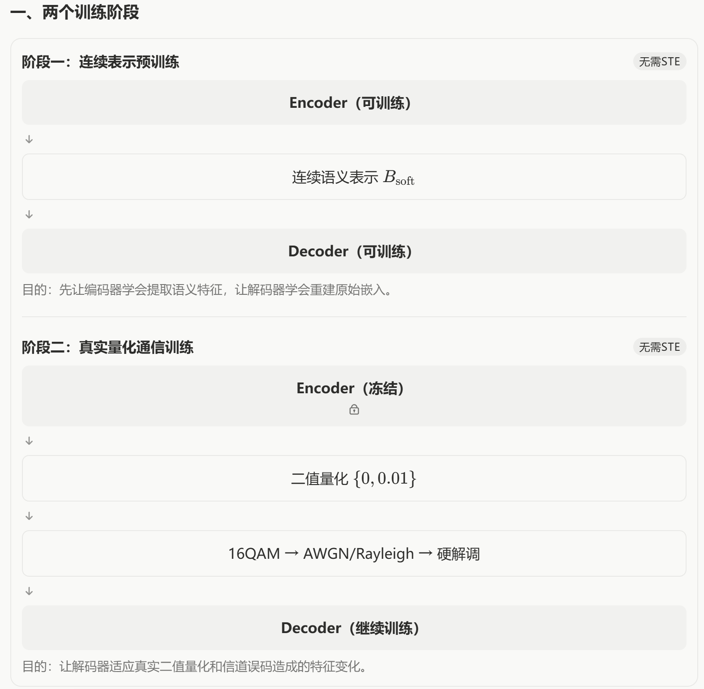
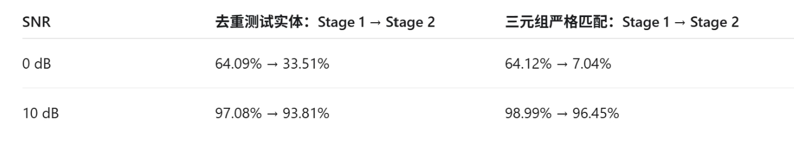

# PTQ实验
**ICML2021**




stage1:
不使用STE①，也暂时不经过真实的16QAM硬比特通信模块。

```python
# 发送端编码器
highway_1 = encoder(input_layer)

# 连续可微表示
soft_bits = Config.A * tf.sigmoid(highway_1 / T)

# 接收端解码器
output = decoder(soft_bits)

# 训练编码器 + 解码器
loss = MSE(input_layer, output)
```

stage2:
冻结编码器的权重，在经过二值量化的16QAM信道后，训练解码器参数
```python
# 加载第一阶段训练好的权重

# 编码器只执行前向计算，不更新参数
highway_1 = encoder(input_layer)

# 真实二值量化，不使用STE
binary = tf.where(
    highway_1 >= 0.0,
    tf.ones_like(highway_1) * Config.A,
    tf.zeros_like(highway_1)
)

# 真实16QAM信道与硬解调
received_bits = qam16_channel(binary)

# 解码器继续训练
output = decoder(received_bits)

loss = MSE(input_layer, output)
```

# 200dim awgn信道
stage1：500epochs
stage2：500epochs
seed: 40 41 42


**w/o STE的结果**
| SNR | 方法 | 实体恢复准确率 | 去重实体准确率 | 三元组精确恢复率 | 频率平衡三元组恢复率 |
|---|---|---:|---:|---:|---:|
| 0 dB | w/o STE①、③ | 28.55% | 17.18% | 2.21% | 3.01% |
| 0 dB | **w/ STE①、③** | **71.76%** | **61.00%** | **29.98%** | **39.20%** |
| 10 dB | w/o STE①、③ | 81.38% | 73.20% | 47.15% | 59.15% |
| 10 dB | **w/ STE①、③** | **82.34%** | **81.10%** | **50.10%** | **66.59%** |