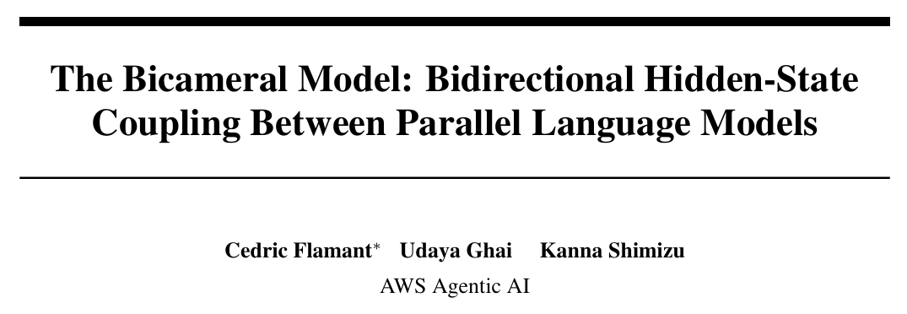
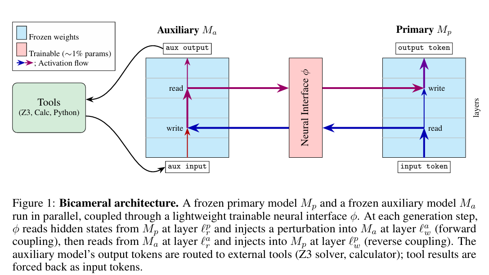
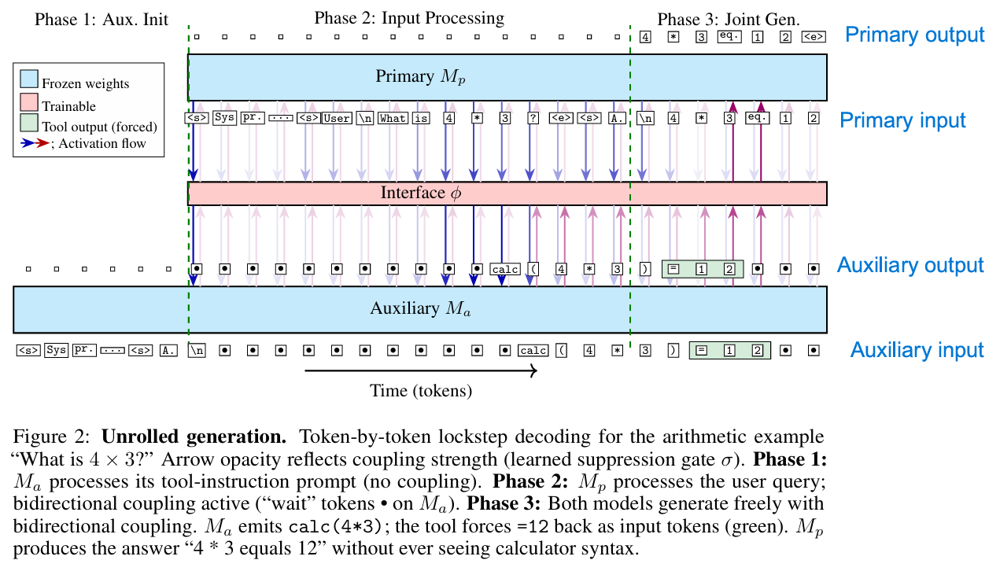
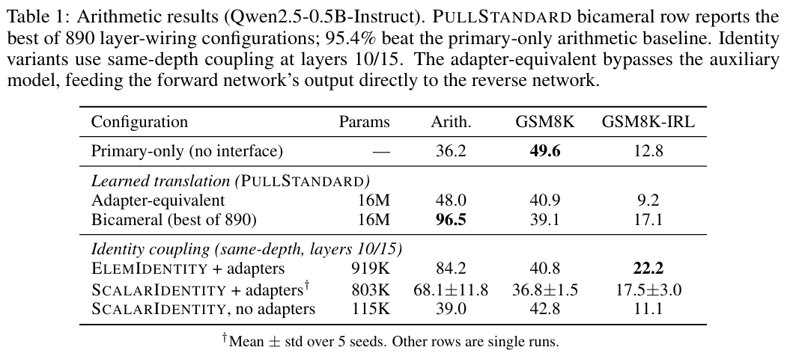
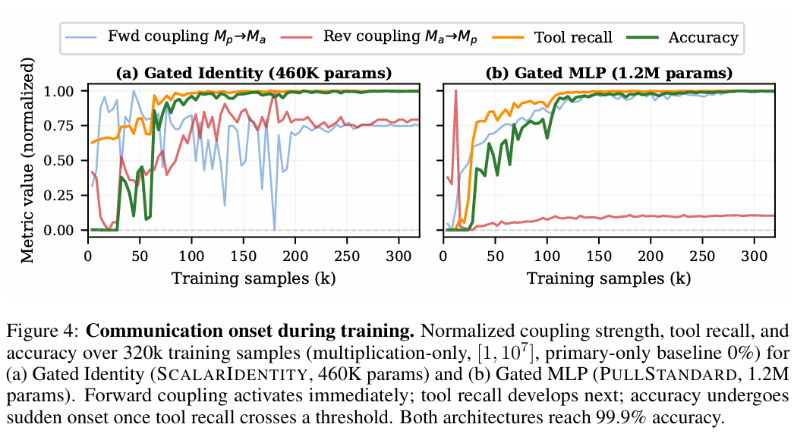
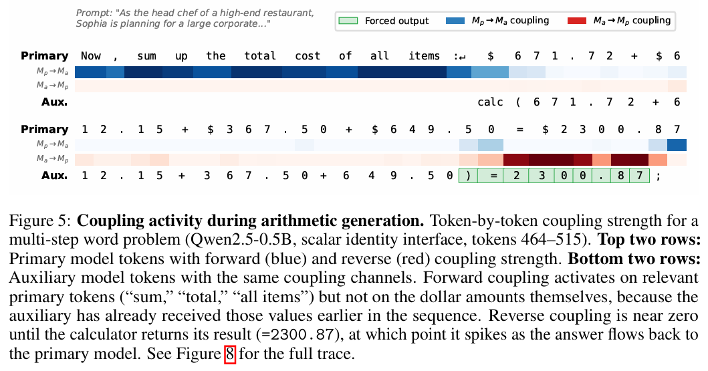
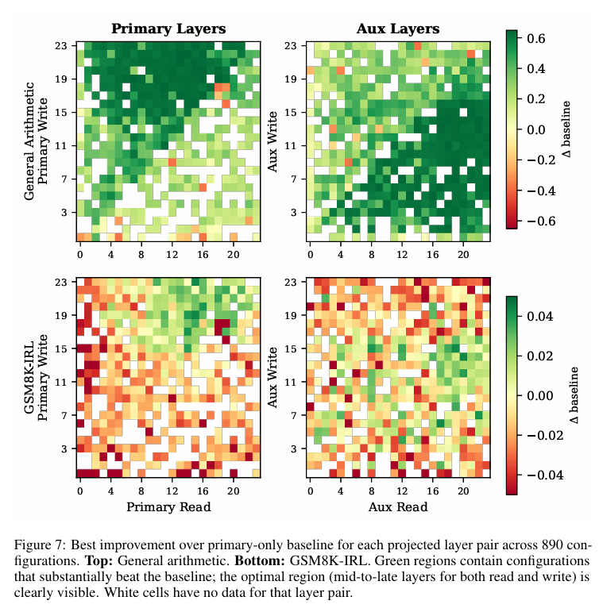

[原文连接](https://arxiv.org/pdf/2605.11167)
## 1. 研究问题与系统输入输出

传统多智能体通常通过文本通信：

\[
\text{hidden state}\rightarrow \text{token/text}\rightarrow \text{hidden state}
\]

本文提出 **Bicameral Model**：

\[
M_p \leftrightarrow \phi \leftrightarrow M_a
\]

- \(M_p\)：Primary Model，读取用户问题并生成最终回答；
- \(M_a\)：Auxiliary Model，不直接看到用户问题，负责调用 Calculator、Z3、Python 等工具；
- \(\phi\)：可训练 Neural Interface，负责两个模型之间的 hidden-state translation 与 gating；
- 两个 LLM 均冻结，只训练接口 \(\phi\)。

系统整体信息流：

\[
\boxed{
\text{User Query}
\rightarrow M_p
\xrightarrow{\text{hidden state}}
M_a
\rightarrow \text{Tool}
\rightarrow M_a
\xrightarrow{\text{hidden state}}
M_p
\rightarrow \text{Answer}
}
\]

Primary 不直接看到工具调用及工具返回文本；Auxiliary 也不直接读取用户问题。

---

## 2. 交互媒介：Residual-stream Hidden State

两个模型传递的是 Transformer 中间层的：

\[
\boxed{\text{residual-stream hidden state}}
\]

作者记为：

\[
h_m^{(\ell)}(t)\in\mathbb R^{d_m}
\]

表示模型 \(m\) 在 token 位置 \(t\)、第 \(\ell\) 个 Transformer block 前的主干 hidden state。

\[
h^{(0)}
\rightarrow \text{Block}
\rightarrow h^{(1)}
\rightarrow \cdots
\rightarrow h^{(L)}
\]

其中 \(\ell=0\) 对应 embedding，\(\ell=L\) 对应最后一个 Transformer block 后、final norm / LM head 前的状态。Bicameral 的通信发生在这条 residual stream 上，而不是直接交换 token、Attention 输出或 KV cache。

---

## 3. 整体架构与单 token 交互



**Figure 1：Bicameral architecture**

每个方向各有一个 read layer 和 write layer：

\[
\ell_r^{p\rightarrow a},\quad
\ell_w^{p\rightarrow a},\quad
\ell_r^{a\rightarrow p},\quad
\ell_w^{a\rightarrow p}
\]

一个 token step 内：

1. Primary 运行到 read layer，得到 \(h_p\)；
2. \(\phi^{p\rightarrow a}\) 将 \(h_p\) 翻译并注入 Auxiliary；
3. Auxiliary 在接收信号后继续经过自身 Transformer layers；
4. 从 Auxiliary read layer 取得 \(h_a\)，通过 \(\phi^{a\rightarrow p}\) 写回 Primary；
5. Primary 完成剩余层并预测下一个 token。

因此一次有效的信息往返为：

\[
\boxed{
M_p^{read}
\rightarrow
\phi^{p\rightarrow a}
\rightarrow
M_a^{write}
\rightarrow
M_a\text{ computation}
\rightarrow
M_a^{read}
\rightarrow
\phi^{a\rightarrow p}
\rightarrow
M_p^{write}
}
\]

关键点是：Auxiliary 不是一个简单 projector。Primary 的信号进入 Auxiliary 后，还会经过 Auxiliary 自身的 Transformer 计算和工具交互，再返回 Primary。

---

## 4. Figure 2：完整交互流程



**Figure 2：Token-by-token lockstep generation**

两个模型按 token **锁步（lockstep）** 运行，分为三个阶段。

### Phase 1：Auxiliary Initialization

Auxiliary 先读取自己的 tool instruction，建立 KV cache。Primary 暂不运行，coupling 关闭。

### Phase 2：Primary Input Processing

Primary 处理用户问题，例如：

```text
What is 4 * 3?
```

这些 token 是 input-forced。Auxiliary 不直接看到问题文本，而是在同步 token stream 中等待，并持续接收：

\[
h_p(t)\rightarrow \phi^{p\rightarrow a}\rightarrow h_a(t)
\]

因此它可以从 Primary 的 latent signal 中恢复任务信息，并开始生成：

```text
calc(4*3)
```

### Phase 3：Joint Generation

Primary 与 Auxiliary 同时自由生成。Auxiliary 完成工具调用后，Calculator 返回：

```text
=12;
```

该结果是 **tool-forced token**，被直接写入 Auxiliary stream。随后：

\[
\text{Tool Result}
\rightarrow M_a
\rightarrow \phi^{a\rightarrow p}
\rightarrow M_p
\]

Primary 最终输出：

```text
4 * 3 equals 12
```

因此 Primary 从未直接看到 `calc(4*3)=12`，工具结果只通过 hidden-state channel 影响 Primary。

> 图中每个模型都有 input/output 两条 token 序列。自由生成时满足  
> \[
> \text{output}_t=\text{input}_{t+1}
> \]
> 因而两条序列天然错开一个 token；tool-forced token 则由外部工具接管。

---

## 5. Neural Interface 结构

核心 coupling operator：

\[
\phi^{p\rightarrow a}(h_p,h_a)
=
(1-\sigma^{p\rightarrow a})h_a
+
\sigma^{p\rightarrow a}f^{p\rightarrow a}(h_p)
\]

其中：

\[
\sigma^{p\rightarrow a}
=
\operatorname{Sigmoid}
\left(g^{p\rightarrow a}(h_a)\right)
\]

reverse direction 完全对称。

### Translation Network \(f\)

\[
f:\mathbb R^{d_p}\rightarrow\mathbb R^{d_a}
\]

负责将 sender hidden state 映射到 receiver 的 representation space。

### Suppression Gate \(g\)

Gate 决定 receiver 接收多少外部信号：

\[
\sigma\approx0 \Rightarrow h_a'\approx h_a
\]

\[
\sigma\approx1 \Rightarrow h_a'\approx f(h_p)
\]

因为 gate 由 receiver hidden state 决定，所以称为 **Pull design**：receiver 自己决定何时、以多大强度接收信息。

---

## 6. PULLSTANDARD 与 PULLIDENTITY

### PULLSTANDARD

\[
f=\text{MLP},\qquad g=\text{MLP}
\]

Arithmetic 实验中，translation MLP 为 3 层、hidden size 2048；gate MLP 更小，hidden size 64。

它同时学习：

\[
\boxed{\text{怎么翻译 hidden state}+\text{什么时候通信}}
\]

### PULLIDENTITY / Gated Identity

直接令：

\[
f(h)=h
\]

则：

\[
h'_a=(1-\sigma)h_a+\sigma h_p
\]

不再学习 translator，只学习 gate，要求两个模型的 hidden size / latent space 足够兼容。

- **Scalar gate**：每个 token 只有一个 \(\sigma\)，整个 hidden vector 使用统一通信强度；
- **Element-wise gate**：\(\boldsymbol{\sigma}\in\mathbb R^d\)，每个 hidden dimension 独立控制融合比例。

Identity 版本还可加入低秩 layer adapter，以帮助后续 Transformer 适应混合后的 hidden state。

---

## 7. 可训练参数与损失函数

### 7.1 更新哪些参数？

PULLSTANDARD 更新：

\[
f^{p\rightarrow a},\;
g^{p\rightarrow a},\;
f^{a\rightarrow p},\;
g^{a\rightarrow p}
\]

中的 MLP 权重与偏置。

PULLIDENTITY 没有 translation 参数，主要训练两个 gate 以及可选 layer adapter。

\[
\boxed{M_p,M_a\text{ 全部冻结}}
\]

梯度可以穿过两个 LLM，但 optimizer 只更新接口参数。

### 7.2 Dual-target Next-Token Prediction

总损失：

\[
\boxed{
L(\theta_\phi)=L_p(\theta_\phi)+L_a(\theta_\phi)
}
\]

其中两项都是 masked next-token cross entropy。

单 token 的 NTP cross entropy 可写为：

\[
\ell_t=-\log P(x_{t+1}^{\text{target}}\mid x_{\le t})
\]

即正确 next token 的概率越高，loss 越低。

**Primary loss \(L_p\)**：监督最终回答是否正确，主要推动 Auxiliary 信息能够通过 reverse coupling 被 Primary 有效利用。

**Auxiliary loss \(L_a\)**：监督 Auxiliary 是否能根据 Primary 的 latent signal 生成正确工具调用，例如：

```text
calc(564*848)
```

工具返回：

```text
=478272;
```

不是 Auxiliary 自己预测的，因此设为：

\[
m_t^{(a)}=0
\]

不计算 Auxiliary loss，但仍作为输入进入 \(M_a\)，并可通过 reverse coupling 影响 Primary。

最终：

\[
L_p=
\frac{\sum_t m_t^{(p)}\ell_t^{(p)}}{\sum_t m_t^{(p)}},
\qquad
L_a=
\frac{\sum_t m_t^{(a)}\ell_t^{(a)}}{\sum_t m_t^{(a)}}
\]

主要被 mask 的位置包括 Primary prompt、Auxiliary system prompt 和 tool-forced output。

这一设计的关键是：论文**没有直接要求两个 hidden state 在几何上相似**，而是通过 token-level behavior loss 训练通信接口：

\[
\boxed{
\text{映射后的 hidden state 是否能让 receiver 做出正确行为}
}
\]

---

## 8. Arithmetic + Calculator 实验

\[
M_p=M_a=\text{Qwen2.5-0.5B-Instruct}
\]

只有 Auxiliary 可以访问 Calculator。



主要结果：

| Configuration | Arithmetic | GSM8K | GSM8K-IRL |
|---|---:|---:|---:|
| Primary-only | 36.2 | **49.6** | 12.8 |
| Adapter-equivalent | 48.0 | 40.9 | 9.2 |
| Bicameral PULLSTANDARD | **96.5** | 39.1 | 17.1 |
| ELEMIDENTITY + adapters | 84.2 | 40.8 | **22.2** |

三个结论：

1. Calculator arithmetic 从 **36.2% 提升到 96.5%**，说明 hidden-state channel 能有效传递任务信息和工具结果。
2. Adapter-equivalent 只有 48.0%，说明提升主要来自 Auxiliary + tool reasoning，而不是接口额外参数量。
3. GSM8K 从 49.6% 降到约 40%，说明当 Primary 本身已经能较好解决任务时，hidden-state perturbation 可能带来比工具增益更大的干扰。

另外，Identity 在 GSM8K-IRL 上达到 22.2%，高于 PULLSTANDARD 的 17.1%，作者将其解释为可能存在 capacity–generalization tradeoff。

---

## 9. Figure 4：通信能力如何形成？


$\boxed{h'_a = (1 - \sigma)h_a + \sigma f(h_p)}$

$\Delta h_{\text{fwd}} = h'_a - h_a$ 

$\Delta h_{\text{fwd}} = (1 - \sigma)h_a + \sigma f(h_p) - h_a$

$\boxed{\Delta h_{\text{fwd}} = \sigma (f(h_p) - h_a)}$


$\boxed{C_{\text{fwd}} = \|\Delta h_{\text{fwd}}\| = \|\sigma (f(h_p) - h_a)\|}$
Figure 4 比较：

- **Gated Identity / SCALARIDENTITY**：\(f(h)=h\)，主要学习 gate；
- **Gated MLP / PULLSTANDARD**：同时学习 translation 与 gate。

训练过程中总体呈现：

\[
\boxed{
\text{Forward Coupling}
\rightarrow
\text{Tool Recall}
\rightarrow
\text{Accuracy}
}
\]

Gated Identity 的 raw hidden states 本身已有一定兼容性，因此初始 tool recall 较高；PULLSTANDARD 需要先学会 translation，所以初始 tool recall 接近 0。随后当 tool recall 达到一定水平后，accuracy 出现快速跃升。

---

## 10. Figure 5：Gate 学会选择性通信



Forward coupling：

\[
M_p\rightarrow M_a
\]

会在 `sum`、`total`、`all items` 等任务相关位置增强。

Reverse coupling：

\[
M_a\rightarrow M_p
\]

则在 Calculator 返回 `=2300.87` 等工具结果时明显增强。

说明作者没有人工规定通信 protocol，但 suppression gate 可以仅通过 task loss 学到：

\[
\boxed{\text{什么时候需要通信}}
\]

而不是让两个模型始终保持强耦合。

---

## 11. Layer 选择



作者进行了 890 组 layer-wiring sweep。结果显示：

\[
\boxed{\text{mid-to-late layers（约 10--20 层）整体更优}}
\]

浅层 coupling 明显较差。一个可能解释是：中后层已经形成较充分的 contextual / task representation，但尚未完全进入最终 token prediction。

同时，效果较好的配置通常满足同一个 token 内：

\[
\boxed{
\text{Primary read}
\rightarrow
\text{Aux write}
\rightarrow
\text{Aux read}
\rightarrow
\text{Primary write}
}
\]

即形成 **within-token round trip**。

---

## 12. 总结

Bicameral Model 的核心可以概括为：

\[
\boxed{
\text{Problem}
\rightarrow
M_p
\xrightarrow{\text{latent}}
M_a
\rightarrow
\text{Tool}
\rightarrow
M_a
\xrightarrow{\text{latent}}
M_p
\rightarrow
\text{Answer}
}
\]

主要特点：

- **交互媒介**：intermediate residual-stream hidden states；
- **交互方式**：token-level、连续、双向 coupling；
- **接口结构**：translation network + receiver-controlled suppression gate；
- **训练方式**：冻结两个 LLM，只通过 \(L_p+L_a\) 的 masked NTP loss 训练接口；
- **核心结果**：在存在明显 capability gap 的任务上收益显著，但在 base model 已经擅长的任务上 hidden-state perturbation 可能带来性能下降。

从 hidden-state communication 的角度看，本文最值得关注的一点是：它不要求 sender / receiver hidden state 在几何上直接对齐，而是用最终 token 行为作为监督信号，学习一个“对 receiver 有功能作用”的通信接口。
