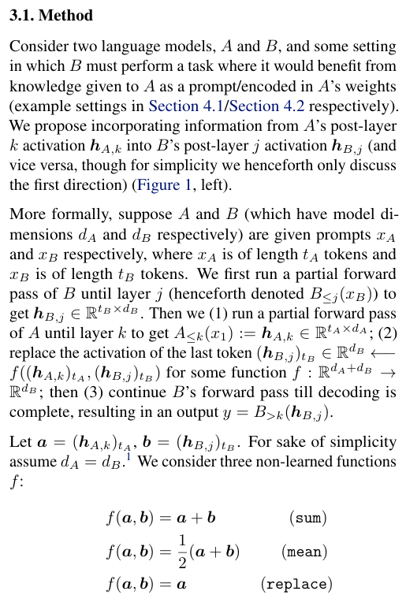
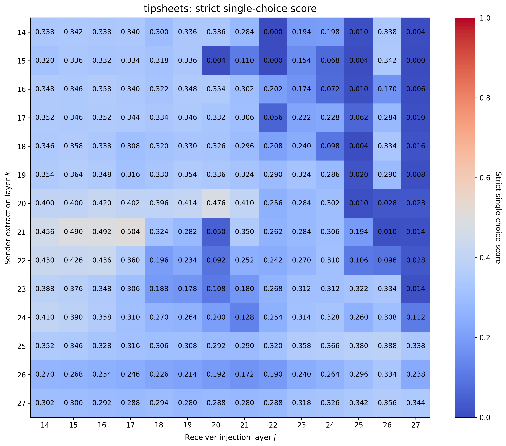
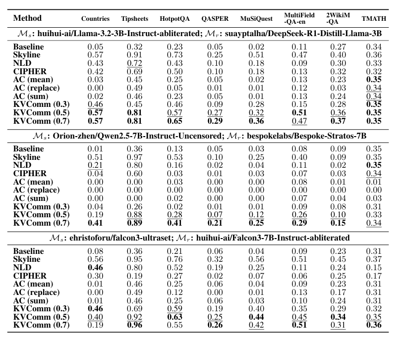
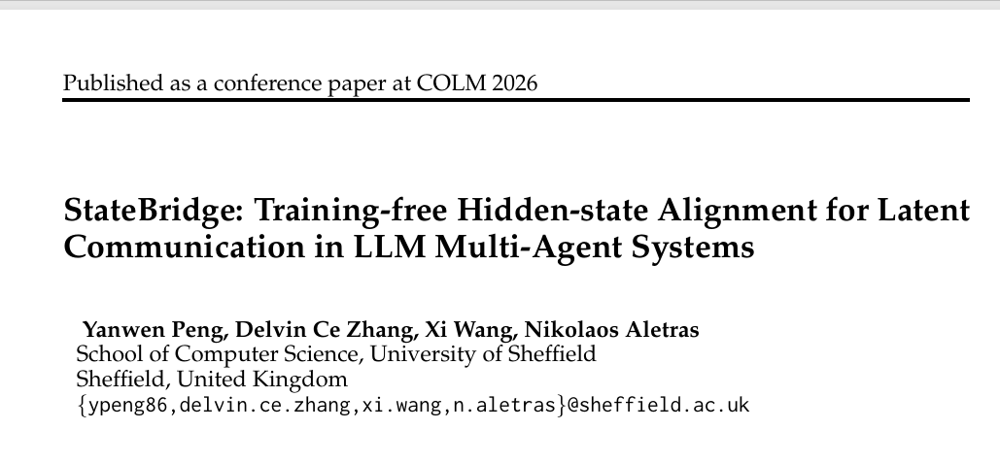
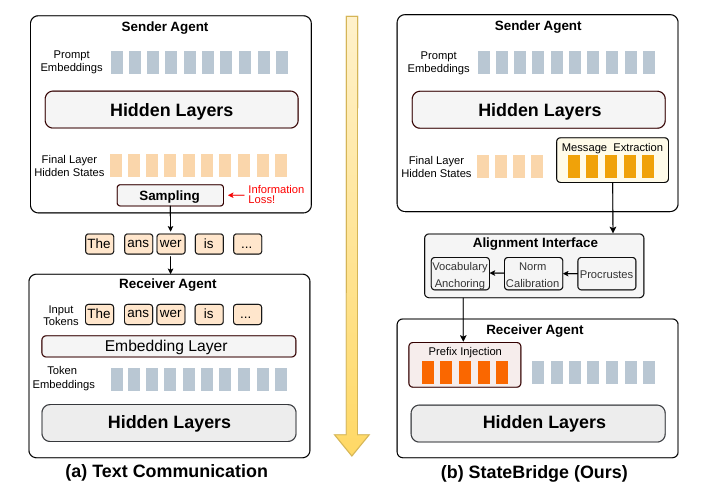
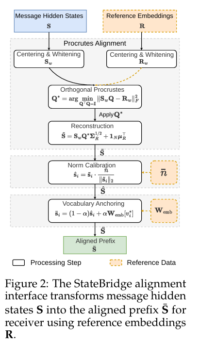
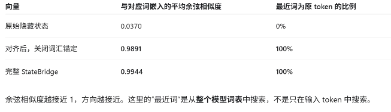

# 论文与代码验证

```python
# model_ac.py
# hidden_A.shape      = [batch_size, seq_len_A, hidden_dim_A]
# hidden_states.shape = [batch_size, seq_len_B, hidden_dim_B]
def apply_hidden_A(hidden_states, hidden_A, f):
    # graft the last token activation from A
    a = hidden_A[:, -1, :]
    b = hidden_states[:, -1, :]

    d = min(a.shape[-1], b.shape[-1])
    d_A = a.shape[-1]
    d_B = b.shape[-1]

    # dimension alignment
    if f == "replace":
        new_vec = torch.cat([
            b[:, :max(0, d_B - d)],
            a[:, max(d_A - d, 0):d_A],
        ], dim=-1)
    elif f == "sum":
        new_vec = torch.cat([
            b[:, :max(0, d_B - d)],
            a[:, max(d_A - d, 0):d_A] + b[:, max(d_B - d, 0):d_B],
        ], dim=-1)
    elif f == "mean":
        new_vec = torch.cat([
            b[:, :max(0, d_B - d)],
            0.5 * (a[:, max(d_A - d, 0):d_A] + b[:, max(d_B - d, 0):d_B]),
        ], dim=-1)
    else:
        raise ValueError(f)
    hidden_states[:, -1, :] = new_vec
    return hidden_states
```

# AC Qwen 7B实验结果
tipsheets任务下表现：
skyline：0.966
silent：0.312

最好的一个点(21,17)
shuffled： 0.338
zero： 0.270

countries数据集结果：
skyline：0.540
silent：0.000
(21,17):0.000


# 原论文模型Llama3.1 8B实验结果
skyline：0.924


# 引用论文的实验结果



# Statebridge论文实验结果



## prefix token=64
```json
"completed_pairs": 100,
  "modes": {
    "none": {
      "original_accuracy": 0.28,
      "swapped_accuracy": 0.32,
      "both_correct_rate": 0.0,
      "invalid_count": 0
    },
    "raw_text": {
      "original_accuracy": 0.96,
      "swapped_accuracy": 0.98,
      "both_correct_rate": 0.95,
      "invalid_count": 0
    },
    "tail_text": {
      "original_accuracy": 0.83,
      "swapped_accuracy": 0.88,
      "both_correct_rate": 0.81,
      "invalid_count": 1
    },
    "tail_embeddings": {
      "original_accuracy": 0.88,
      "swapped_accuracy": 0.86,
      "both_correct_rate": 0.84,
      "invalid_count": 0
    },
    "statebridge": {
      "original_accuracy": 0.88,
      "swapped_accuracy": 0.86,
      "both_correct_rate": 0.84,
      "invalid_count": 0
    },
    "mismatched": {
      "original_accuracy": 0.2,
      "swapped_accuracy": 0.18,
      "both_correct_rate": 0.0,
      "invalid_count": 94
    }
    }
```
## prefix token=16
```json
"none": {
    "original_accuracy": 0.32,
    "swapped_accuracy": 0.32,
    "both_correct_rate": 0.0,
    "invalid_count": 0
  },
  "raw_text": {
    "original_accuracy": 0.98,
    "swapped_accuracy": 1.0,
    "both_correct_rate": 0.98,
    "invalid_count": 0
  },
  "tail_text": {
    "original_accuracy": 0.3,
    "swapped_accuracy": 0.5,
    "both_correct_rate": 0.12,
    "invalid_count": 0
  },
  "tail_embeddings": {
    "original_accuracy": 0.36,
    "swapped_accuracy": 0.44,
    "both_correct_rate": 0.14,
    "invalid_count": 0
  },
  "statebridge": {
    "original_accuracy": 0.36,
    "swapped_accuracy": 0.46,
    "both_correct_rate": 0.16,
    "invalid_count": 0
  },
  "mismatched": {
    "original_accuracy": 0.36,
    "swapped_accuracy": 0.3,
    "both_correct_rate": 0.0,
    "invalid_count": 6
  }
```

实验发现tail_embeddings和statebridge的结果几乎一样，进一步检查发现，答案分布也是类似的，statebridge即使经过全部的transfomer处理和上下文的融合，但未能有效利用上下文信息？hidden states经过对齐变换反而退化成了token embedding表示



# shape-like/representation alignment
AC,Statebridge
# function-like/prefix adapter
Interlat,ThoughtComm